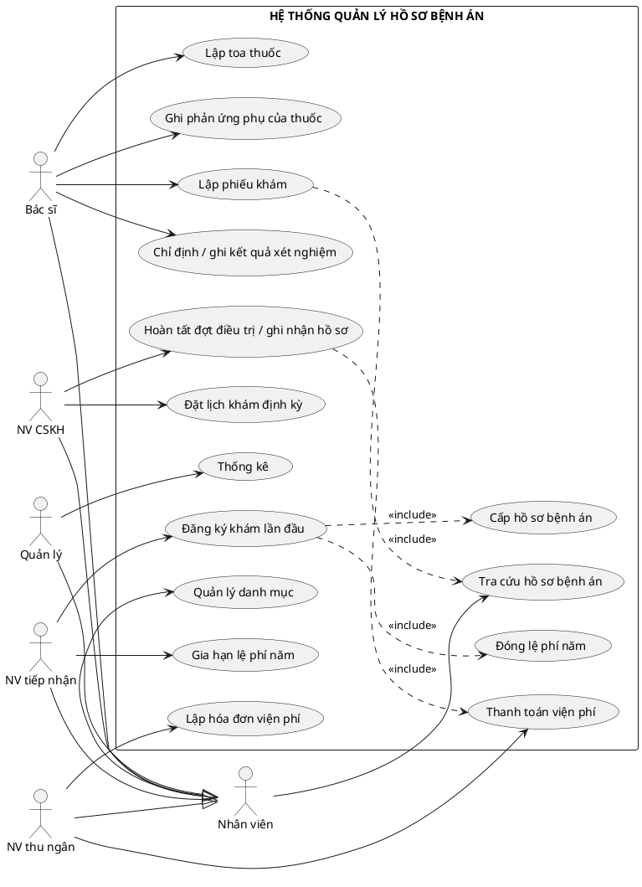
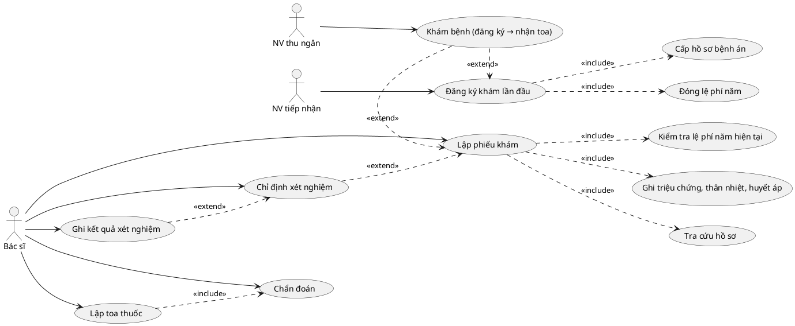
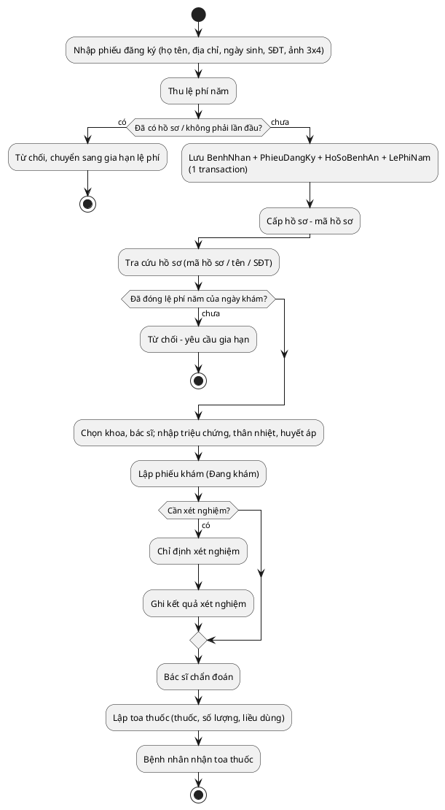
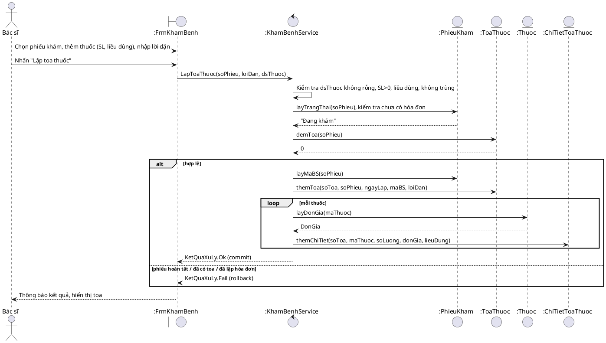

# BÀI 5 – QUẢN LÝ HỒ SƠ BỆNH ÁN (HUTECH – Phân tích thiết kế HĐT)

> Các sơ đồ dưới đây viết bằng **PlantUML** (dán vào plantuml.com/plantuml hoặc extension PlantUML của VS Code để xem), sau đó vẽ lại trong **StarUML** theo đúng nội dung. Mọi tên lớp/bảng/hàm khớp 1-1 với mã nguồn.

## Quyết định triển khai (đề không nêu rõ)
- "Hằng năm" = **năm dương lịch**; lệ phí lưu ở bảng `LePhiNam`, duy nhất theo (hồ sơ, năm). Khám bệnh/đặt lịch định kỳ **chỉ được khi đã đóng lệ phí năm của ngày khám**.
- Khám định kỳ theo quý **miễn phí toàn bộ** (hóa đơn 0đ, tự "Đã thanh toán"); mỗi hồ sơ tối đa 1 lịch còn hiệu lực/quý (filtered UNIQUE index).
- Thông tin khám được **ghi nhận hoàn tất** (xuất viện) chỉ sau khi hóa đơn viện phí thanh toán đủ; do nhân viên phòng CSKH thực hiện.
- Giá xét nghiệm/thuốc được **chụp lại** (snapshot) vào chi tiết để đổi giá danh mục không làm lệch hóa đơn cũ.
- Bệnh nhân không thao tác trực tiếp trên hệ thống WinForms nội bộ nên không mô hình hóa là Actor (giống Bài 3). Nếu giảng viên yêu cầu, có thể thêm Actor "Bệnh nhân" gắn với UC Đăng ký/Đặt lịch.

---
## Câu 1 – Class, thuộc tính, phương thức, ID
| Class | Thuộc tính (**ID**) | Phương thức chính |
|---|---|---|
| BenhNhan | **MaBN**, HoTen, DiaChi, NgaySinh, SoDienThoai, Anh | themBenhNhan(), timKiem() |
| PhieuDangKy | **SoPhieuDK**, NgayLap | taoPhieu() |
| HoSoBenhAn | **MaHoSo**, NgayCap | capHoSo(), traCuuHoSo(), layLichSu() |
| LePhiNam | **MaLePhi**, Nam, SoTien, NgayDong | dongLePhi(), kiemTraLePhiNam() |
| NhanVien | **MaNV**, HoTen, VaiTro, SoDienThoai | themNhanVien() |
| Khoa | **MaKhoa**, TenKhoa, PhiKham | themKhoa() |
| BacSi | **MaBS**, HoTen, ChuyenMon | themBacSi(), layTheoKhoa() |
| LichHen | **MaLichHen**, Quy, Nam, NgayGioHen, TrangThai | datLich(), huy() |
| PhieuKham | **SoPhieuKham**, NgayGioKham, LoaiKham, TrieuChung, ThanNhiet, HuyetAp, ChanDoan, TrangThai, NgayGhiNhan | taoPhieu(), capNhatChanDoan(), hoanTat() |
| XetNghiem | **MaXN**, TenXN, DonGia | themXetNghiem() |
| ChiTietXetNghiem | **(SoPhieuKham, MaXN)**, DonGia, KetQua, NgayThucHien | chiDinh(), ghiKetQua() |
| Thuoc | **MaThuoc**, TenThuoc, DonViTinh, DonGia | themThuoc() |
| ToaThuoc | **SoToa**, NgayLap, LoiDan | lapToa(), tongTien() |
| ChiTietToaThuoc | **(SoToa, MaThuoc)**, SoLuong, DonGia, LieuDung, PhanUngPhu, ThanhTien | themChiTiet(), ghiPhanUng() |
| HoaDonVienPhi | **SoHoaDon**, NgayLap, TienKham, TienXetNghiem, TienThuoc, TongTien, TrangThai | lapHoaDon(), capNhatTrangThai() |
| ThanhToanVienPhi | **MaThanhToan**, NgayThanhToan, HinhThuc, SoTien | themGiaoDich(), tongDaThanhToan() |

## Câu 2 – Liên kết và bản số
Khóa ngoại **không** vẽ thành thuộc tính mà thể hiện bằng association + multiplicity; đầu phiếu–chi tiết dùng **composition** (hình thoi đặc).

```plantuml
@startuml
hide circle
class BenhNhan{MaBN{id}\nHoTen\nDiaChi\nNgaySinh\nSoDienThoai\nAnh}
class PhieuDangKy{SoPhieuDK{id}\nNgayLap}
class HoSoBenhAn{MaHoSo{id}\nNgayCap}
class LePhiNam{MaLePhi{id}\nNam\nSoTien\nNgayDong}
class NhanVien{MaNV{id}\nHoTen\nVaiTro\nSoDienThoai}
class Khoa{MaKhoa{id}\nTenKhoa\nPhiKham}
class BacSi{MaBS{id}\nHoTen\nChuyenMon}
class LichHen{MaLichHen{id}\nQuy\nNam\nNgayGioHen\nTrangThai}
class PhieuKham{SoPhieuKham{id}\nNgayGioKham\nLoaiKham\nTrieuChung\nThanNhiet\nHuyetAp\nChanDoan\nTrangThai\nNgayGhiNhan}
class XetNghiem{MaXN{id}\nTenXN\nDonGia}
class ChiTietXetNghiem{DonGia\nKetQua\nNgayThucHien}
class Thuoc{MaThuoc{id}\nTenThuoc\nDonViTinh\nDonGia}
class ToaThuoc{SoToa{id}\nNgayLap\nLoiDan}
class ChiTietToaThuoc{SoLuong\nDonGia\nLieuDung\nPhanUngPhu}
class HoaDonVienPhi{SoHoaDon{id}\nNgayLap\nTienKham\nTienXetNghiem\nTienThuoc\nTongTien\nTrangThai}
class ThanhToanVienPhi{MaThanhToan{id}\nNgayThanhToan\nHinhThuc\nSoTien}
BenhNhan "1" -- "1" PhieuDangKy
PhieuDangKy "1" -- "1" HoSoBenhAn
BenhNhan "1" -- "1" HoSoBenhAn
HoSoBenhAn "1" *-- "1..*" LePhiNam
HoSoBenhAn "1" -- "0..*" LichHen
HoSoBenhAn "1" -- "0..*" PhieuKham
LichHen "0..1" -- "0..1" PhieuKham
Khoa "1" -- "0..*" BacSi
Khoa "1" -- "0..*" PhieuKham
BacSi "1" -- "0..*" PhieuKham
PhieuKham "1" *-- "0..*" ChiTietXetNghiem
XetNghiem "1" -- "0..*" ChiTietXetNghiem
PhieuKham "1" -- "0..1" ToaThuoc
ToaThuoc "1" *-- "1..*" ChiTietToaThuoc
Thuoc "1" -- "0..*" ChiTietToaThuoc
PhieuKham "1" -- "0..1" HoaDonVienPhi
HoaDonVienPhi "1" *-- "0..*" ThanhToanVienPhi
NhanVien "1" -- "0..*" PhieuDangKy : tiếp nhận
NhanVien "1" -- "0..*" LePhiNam : thu
NhanVien "1" -- "0..*" LichHen : đặt lịch
NhanVien "1" -- "0..*" HoaDonVienPhi : lập
NhanVien "0..1" -- "0..*" PhieuKham : ghi nhận
@enduml
```

## Câu 3 – Actor và Use Case tổng quát
Actor: **Nhân viên** (tổng quát) ← **NV tiếp nhận**, **NV CSKH**, **NV thu ngân**, **Quản lý**; **Bác sĩ** (kế thừa Nhân viên để tra cứu hồ sơ).



## Câu 4 – Use Case phân rã: từ đăng ký khám → xét nghiệm → nhận toa thuốc


## Câu 5 – Activity Diagram cho Câu 4


## Câu 6 – Sequence Diagram “Lập toa thuốc”


---
## Thiết kế CSDL (rút gọn)
16 bảng: NhanVien, Khoa, BacSi, BenhNhan, PhieuDangKy, HoSoBenhAn, LePhiNam, LichHen, PhieuKham, XetNghiem, ChiTietXetNghiem, Thuoc, ToaThuoc, ChiTietToaThuoc, HoaDonVienPhi, ThanhToanVienPhi.
Ràng buộc chính: `UNIQUE(PhieuDangKy.MaBN)` (đăng ký lần đầu), `UNIQUE(LePhiNam: MaHoSo,Nam)`, `UNIQUE(ToaThuoc.SoPhieuKham)`, `UNIQUE(HoaDonVienPhi.SoPhieuKham)`, chỉ mục unique có điều kiện `LichHen(MaHoSo,Quy,Nam) WHERE TrangThai<>N'Hủy'`, CHECK loại khám/trạng thái/hình thức thanh toán/thân nhiệt.

## Kiểm thử
| TC | Điều kiện | Thao tác | Kết quả mong đợi |
|---|---|---|---|
| TC01 | Bệnh nhân mới, nhập đủ, lệ phí > 0 | Đăng ký & cấp hồ sơ | Tạo BenhNhan+PhieuDangKy+HoSo+LePhi, trả mã hồ sơ |
| TC02 | Lệ phí = 0 | Đăng ký | Từ chối |
| TC03 | Trùng họ tên + ngày sinh + SĐT | Đăng ký | Từ chối (không phải lần đầu) |
| TC04 | Hồ sơ đã có, nhập mã/tên/SĐT | Tra cứu | Hiện hồ sơ + lịch sử khám |
| TC05 | Hồ sơ chưa đóng lệ phí năm khám | Lập phiếu khám | Từ chối, yêu cầu gia hạn |
| TC06 | Gia hạn năm đã đóng | Gia hạn | Từ chối |
| TC07 | Khám điều trị, thiếu triệu chứng | Lập phiếu | Từ chối |
| TC08 | Bác sĩ không thuộc khoa | Lập phiếu | Từ chối |
| TC09 | Phiếu Đang khám, XN hợp lệ | Chỉ định XN | Thêm; chỉ định trùng bị từ chối |
| TC10 | Phiếu Đang khám, toa hợp lệ | Lập toa | Tạo toa + chi tiết, 1 transaction |
| TC11 | Phiếu đã có toa | Lập toa lần 2 | Từ chối |
| TC12 | Phiếu đã lập hóa đơn | Thêm XN / lập toa | Từ chối |
| TC13 | Có lệ phí, quý chưa có lịch | Đặt lịch định kỳ | Thành công |
| TC14 | Quý đã có lịch còn hiệu lực | Đặt lịch lần 2 | Từ chối; hủy rồi đặt lại được |
| TC15 | Giờ hẹn ngoài quý / quá khứ | Đặt lịch | Từ chối |
| TC16 | Khám định kỳ không chọn lịch hẹn | Lập phiếu | Từ chối |
| TC17 | Khám định kỳ theo lịch | Lập hóa đơn | 0đ, tự Đã thanh toán; lịch → Đã khám |
| TC18 | Khám điều trị có XN + toa | Lập hóa đơn | Khám + XN + thuốc đúng tổng |
| TC19 | Thanh toán một phần | Ghi giao dịch | Hóa đơn vẫn Chưa thanh toán |
| TC20 | Thanh toán vượt số còn lại | Ghi giao dịch | Từ chối |
| TC21 | Thanh toán đủ | Ghi giao dịch | Đã thanh toán |
| TC22 | Hóa đơn chưa đủ | Hoàn tất | Từ chối |
| TC23 | Hóa đơn đã đủ | Hoàn tất | Phiếu → Hoàn tất, ghi NV + thời điểm |
| TC24 | Phiếu Hoàn tất | Sửa chẩn đoán/XN | Từ chối |
| TC25 | Khoảng ngày hợp lệ | Thống kê | Có số liệu tổng hợp + thuốc đã kê |

## Truy vết yêu cầu → thiết kế → code
| Yêu cầu | UC / Form | Service | Bảng | Test |
|---|---|---|---|---|
| Đăng ký lần đầu + lệ phí + cấp hồ sơ | FrmTiepNhan | TiepNhanService.DangKyMoi | BenhNhan, PhieuDangKy, HoSoBenhAn, LePhiNam | TC01-03 |
| Gia hạn lệ phí hằng năm | FrmTiepNhan | TiepNhanService.GiaHanLePhi | LePhiNam | TC05-06 |
| Tra cứu hồ sơ/lịch sử | FrmKhamBenh | TiepNhanService.TraCuuHoSo, KhamBenhService.LayLichSu | HoSoBenhAn, PhieuKham | TC04 |
| Phiếu khám, triệu chứng | FrmKhamBenh | KhamBenhService.TaoPhieuKham | PhieuKham | TC05,07,08 |
| Xét nghiệm | FrmKhamBenh | ThemXetNghiem, CapNhatKetQuaXN | ChiTietXetNghiem | TC09,12 |
| Toa thuốc, phản ứng phụ | FrmKhamBenh | LapToaThuoc, GhiNhanPhanUng | ToaThuoc, ChiTietToaThuoc | TC10-12 |
| Lịch định kỳ theo quý | FrmLichHen | LichHenService | LichHen | TC13-17 |
| Viện phí, hoàn tất | FrmVienPhi | VienPhiService | HoaDonVienPhi, ThanhToanVienPhi, PhieuKham | TC17-24 |
| Thống kê | FrmThongKe | ThongKeService | các bảng nghiệp vụ | TC25 |
